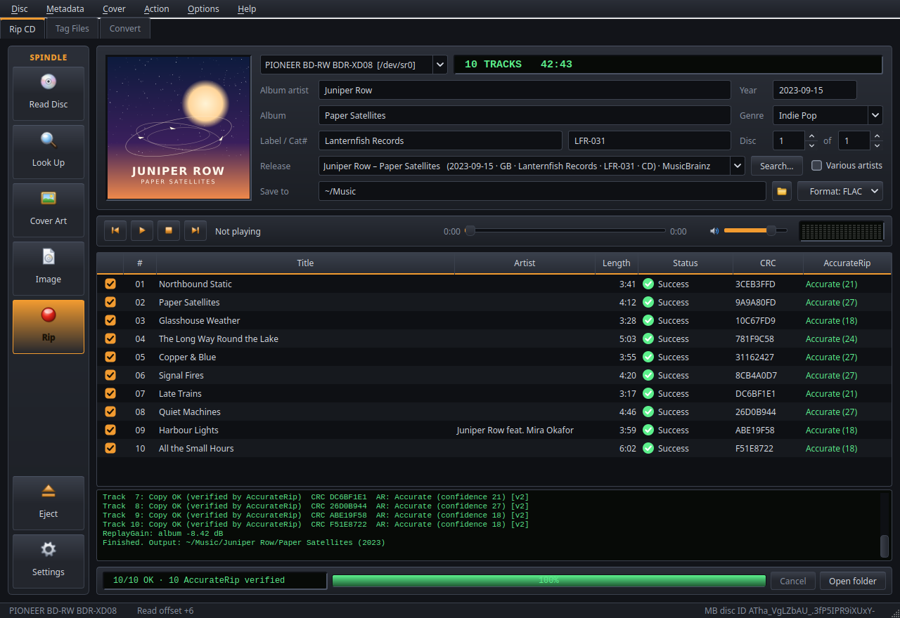
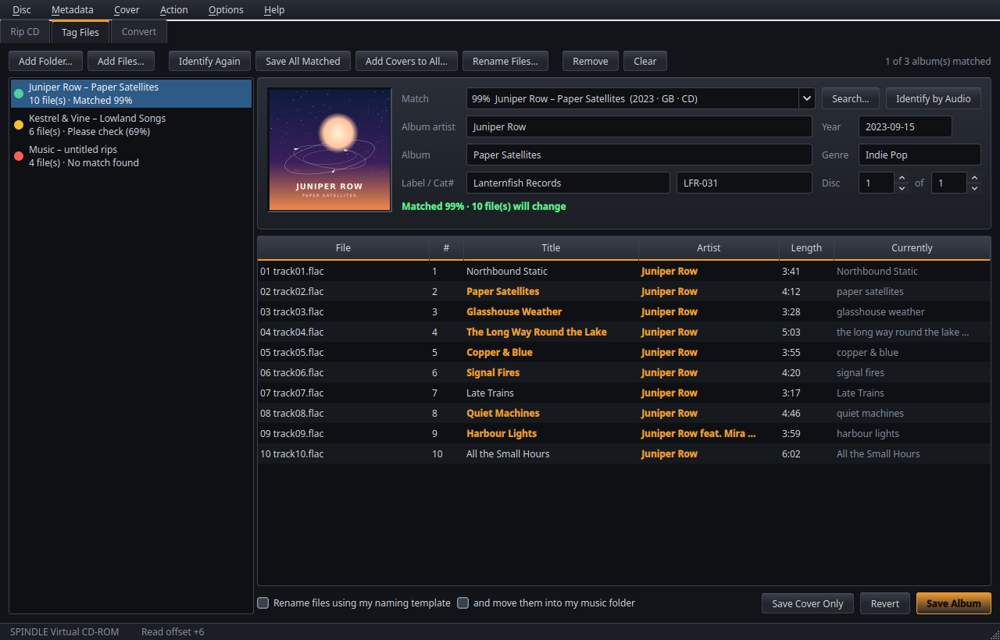
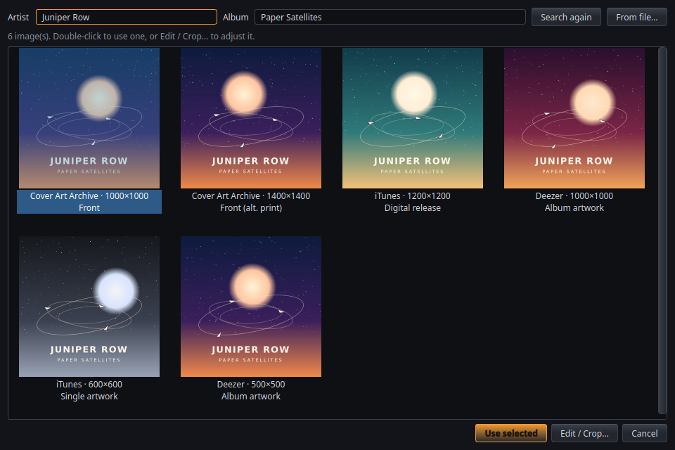
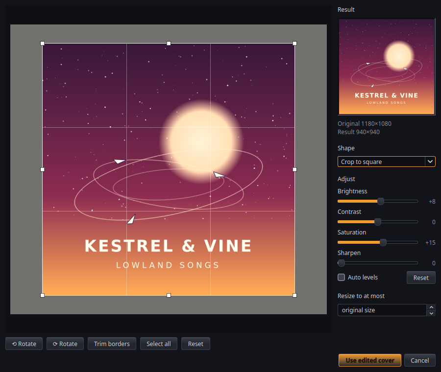
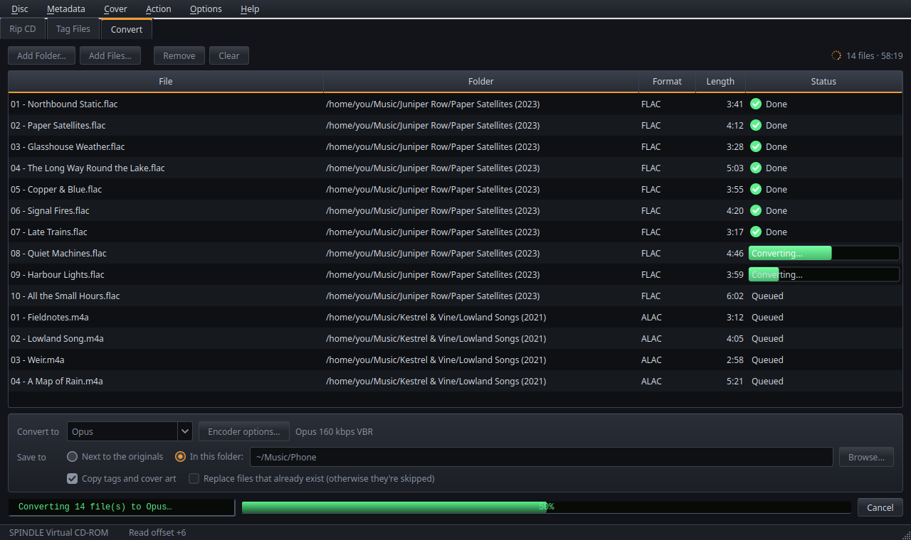
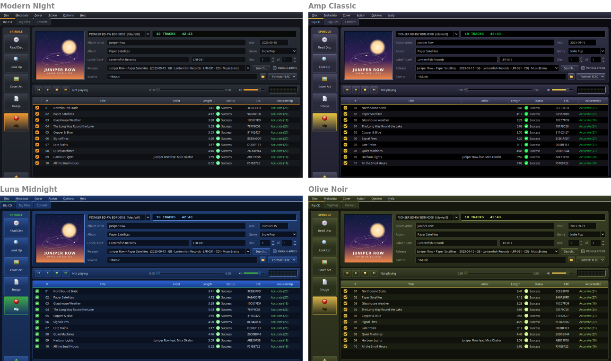

# Spindle

> **Made with Claude.** The code in this project was written by [Claude](https://claude.ai), Anthropic's
> AI assistant, through many rounds of my requests, testing and feedback on real discs. I directed the
> design and tested it; I don't claim credit for writing the code.



An all-in-one secure CD ripper for Linux and Windows. Put a disc in, and Spindle reads it,
looks it up, finds the cover, rips it securely, verifies it against AccurateRip, encodes it to as
many formats as you like, tags everything and writes a log — in one window. It also plays CDs, fixes
the tags and artwork of music you already have, and converts it to other formats.

## Install

### Windows

Download **SpindleSetup-x.y.z.exe** from the [releases page](https://github.com/voidxzero/spindle/releases/latest)
and run it (no administrator rights needed), or take the **portable zip** and unzip it anywhere. Everything
Spindle needs, including ffmpeg, is included.

Windows may warn that the installer is from an unknown publisher (it isn't code-signed): choose
*More info* ▸ *Run anyway*.

### Linux

```sh
git clone https://github.com/voidxzero/spindle.git
cd spindle
./install.sh
```

The installer uses your package manager (apt, dnf, pacman or zypper) to install `cdparanoia` and the
encoders, sets up a private Python environment and adds **Spindle** to your application menu. If it
says you can't read the drive, add yourself to the group it names (`sudo usermod -aG cdrom $USER`) and
log in again. On GNOME, set **Settings ▸ Apps ▸ Default Apps ▸ Audio CD** to *Spindle* or *Do nothing*
so no other app grabs the drive.

### Updates

Spindle checks for a new version when it starts and offers to install it; your settings are kept.
**Help ▸ Check for updates…** checks any time.

## First run: your drive's read offset

Every drive model reads audio a few samples early or late, and without correcting that AccurateRip
can't confirm your rips. Spindle offers to set it up the first time: **Look up automatically** finds
your model in AccurateRip's drive list. If your drive isn't listed, put in any well-known CD and use
**Settings ▸ Drive ▸ Detect with a key disc…**. Spindle remembers the offset for each drive.

## Ripping

- **Secure:** each track is checked against AccurateRip as soon as it's read. If AccurateRip can't
  confirm it, Spindle reads it again (test & copy) and re-reads more on a mismatch. On Linux it uses
  cdparanoia; on Windows it reads the drive directly, re-reading bad spots sector by sector.
- **Metadata and covers:** MusicBrainz (with composers, ISRCs, labels, catalog numbers and genres) and
  GnuDB, or search by artist and album. Cover art from Cover Art Archive, iTunes and Deezer.
- **Formats:** FLAC, ALAC, WavPack, WAV, MP3, Opus, Ogg Vorbis and AAC, several at once, encoded while
  the next track is read. Full tags, embedded cover, ReplayGain, and a detailed `.log`, `.cue` and
  `.m3u8`. A single-file image with a cue sheet is one click away (**Image**).
- **Retry failed** rips just the tracks that went wrong and fixes the album's log and playlist.
- **Automatic ripping** (Settings ▸ Drive): insert a disc and Spindle looks it up and rips it after a
  short countdown; with *Eject when finished* you can feed discs in one after another.
- **Play CDs** from the bar under the album details: gapless, with instant seeking.

## How Spindle checks a rip

- **AccurateRip, per track.** After each track is read, Spindle computes its AccurateRip v1 and v2
  checksums and compares them with the database's submissions for every pressing of the disc. A match
  shows as **Accurate (n)**, where *n* is how many other people's rips agree (the confidence). As the
  AccurateRip method requires, the first 5 sectors of the first track and the last 5 of the last track
  are left out of the checksum.
- **Read offset correction**, from AccurateRip's drive list or measured with a key disc. Without it,
  perfect rips can't match the database.
- **Test & copy** when AccurateRip can't confirm a track (disc not in the database, or no match): the
  track is read again and the two CRC32s compared. If they differ, Spindle keeps reading (2 extra passes
  by default) until two reads agree. A track where no two reads agree is marked as failed.
- **Reading.** On Linux, cdparanoia in its full secure mode (overlap checking and jitter correction),
  with up to 20 re-reads of a bad sector. On Windows, Spindle reads the drive directly: a block that
  fails is re-read sector by sector (up to 20 times each), and before reading a stretch a second time it
  reads elsewhere on the disc first, so the drive's cache can't fake a test & copy match.
- **Results you can check.** Each track ends as **Success** (an AccurateRip match, or two identical reads
  with every sector read cleanly), **Not verified** (the reads agree but AccurateRip has a different
  checksum) or **failed**, and *Retry failed* reads just those again. The `.log` lists, per track: copy
  and test CRC, AccurateRip v1/v2 with confidence, peak level, corrections and the times of any
  suspicious positions, plus the drive, read offset and settings used.
- **Unreadable sectors are never hidden**: they're counted and logged with their positions. Two reads
  that agree don't prove a bad spot was read right, so unless AccurateRip confirms the audio, a track
  with unreadable sectors is marked as failed, not as a success.

## Online services and privacy

Spindle has no account, no telemetry and no analytics. It talks to these services, and only for these
things:

| Service | Used for | What it's sent |
|---|---|---|
| [MusicBrainz](https://musicbrainz.org) | Album details; disc and text search | The disc ID (from the track layout), or the artist/album you search for |
| [GnuDB](https://gnudb.org) (FreeDB's successor) | Album details when MusicBrainz has none | The FreeDB disc ID and track positions, as user *anonymous* at host *localhost* (the protocol asks for both; you can change the user name) |
| [AccurateRip](http://www.accuraterip.com) | Checksums to verify rips; drive offset list | The disc's AccurateRip IDs (from the track layout). Spindle only reads from AccurateRip; it never submits your rips |
| [Cover Art Archive](https://coverartarchive.org) | Covers | The MusicBrainz release ID |
| iTunes Search and Deezer | More covers | The artist and album name |
| [AcoustID](https://acoustid.org) | Identifying untagged files by sound (optional) | Audio fingerprints and lengths, only if you add your own API key |
| GitHub | Update check | Nothing beyond the request (turn it off in Settings ▸ Updates) |

Every request identifies itself as *Spindle* (MusicBrainz asks apps to), and MusicBrainz is queried at
most once a second, as its rules ask. The metadata and cover sources can be turned off or reordered in
Settings ▸ Metadata and ▸ Cover art (AccurateRip is the verification itself, so it always runs). Plugins
you add yourself, like the Discogs example, can contact other services. Settings and the crash log stay
on your computer.

## Your files

- **Ripping** writes only to the music folder you choose; temporary files stay in your own cache folder.
- **Tag Files** changes only the tags Spindle manages (ReplayGain, lyrics, ratings and other apps' tags
  are kept), and shows every change, and every rename or move, before anything is written.
- **Convert** never changes or deletes the originals, and skips files that already exist unless you
  tick *Replace*.

## Tag Files: fix music you already have



Drop a folder into the **Tag Files** tab. Spindle groups the files into albums and looks each one up on
MusicBrainz, using IDs already in the files, the tags, or the folder name. Each album gets a status:
**green** = matched, **amber** = please check, **red** = no match. Changes are shown in **bold colour**
with the old value in *Currently*, and track lengths that don't fit are flagged. Edit anything, pick
another release or **Search…**; untagged files can be identified by their audio (AcoustID). **Save
Album** only replaces the fields Spindle manages, so ReplayGain, lyrics and ratings are kept. Spindle
can also rename files from their tags, with a preview first (**Rename Files…**).

## Cover art



Spindle picks a good-sized cover automatically, or choose from everything it found. To add artwork
without touching any tags, use **Save Cover Only**, or **Add Covers to All…** for a whole list.



Right-click any cover ▸ **Edit / crop…** to crop, trim scanner borders, fit or stretch to a square,
rotate, adjust brightness, contrast, saturation and sharpness, fix a faded scan with *Auto levels*, or
resize it.

## Convert



The **Convert** tab turns music you already have into another format, such as FLAC to Opus or MP3 for
your phone. Save next to the originals or into another folder (subfolders are kept). Tags and cover art
are copied, 24-bit audio stays 24-bit for lossless formats, and your originals are never changed.

## Look



Spindle starts in **Modern Night** on Linux and **Amp Classic** on Windows. *Options ▸ Skin* also has
**Luna Midnight**, **Olive Noir** and **System**, which follows your desktop's light or dark theme. On
Windows the title bar takes the skin's colours too.

## More

- **File names** come from a template (Settings ▸ Output), e.g.
  `%albumartist%/%album% [(%year%)]/[%disc%-]%tracknumber% - %title%`; anything in `[brackets]` is left
  out when its field is empty.
- **Plugins:** drop a `.py` file with a `MetadataProvider` or `CoverProvider` subclass into
  `~/.local/share/spindle/plugins/` (`%LOCALAPPDATA%\Spindle\plugins` on Windows).
  `plugins/discogs.py` is a complete example.
- **Command line** (Linux): `spindle-cli -f flac -f opus` rips with your saved settings.
- **No disc handy?** `spindle --simulate` adds a virtual drive so you can try the whole flow.
- **Versions:** Linux and Windows have their own version numbers and changelogs:
  [CHANGELOG.md](CHANGELOG.md) (Linux) and [CHANGELOG-windows.md](CHANGELOG-windows.md) (Windows).
- **Tests:** `python3 tests/test_engine.py` and the other `tests/test_*.py` files; none need a disc.

## Not (yet) supported

- Hidden track one audio (HTOA) and pre-gap detection, and CD-Text reading.
- C2 error pointers (Spindle relies on re-reads, test & copy and AccurateRip instead).
- Overreading into the lead-in/lead-out: with a non-zero offset, the few samples that would come from
  outside the disc's audio are filled with silence, as in most rippers. AccurateRip's checksums leave
  those samples out, so verification isn't affected.
- Submitting rips to AccurateRip.

## License

Spindle is free software, released under the [GNU General Public License v3.0](LICENSE).
